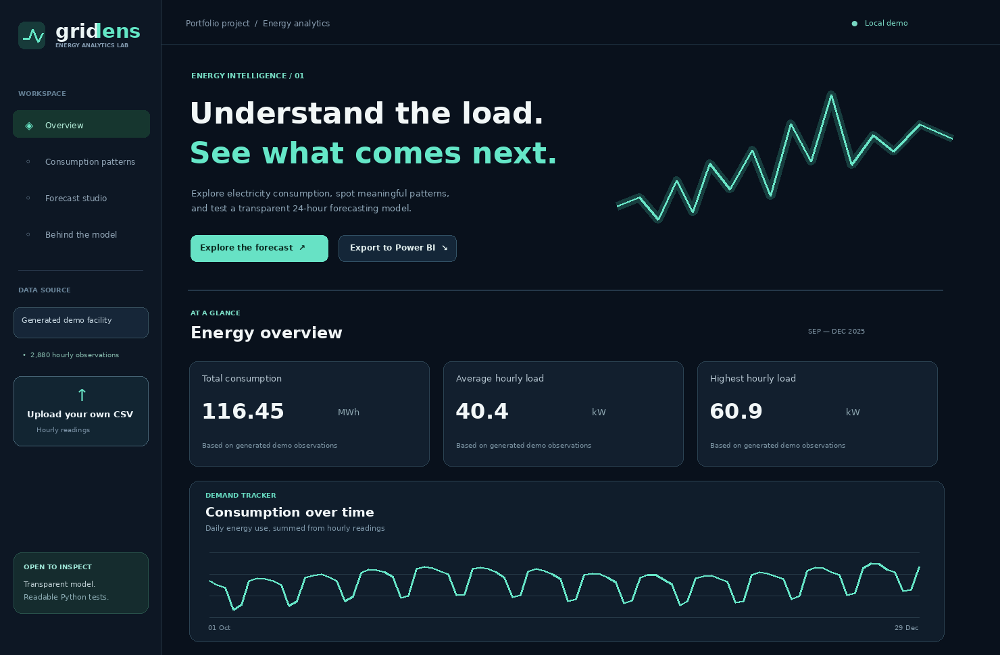

# GridLens

**A small energy dashboard with a forecasting model you can actually question.**

I wanted a way to explore electricity consumption without jumping straight to a complicated forecasting system. GridLens takes hourly readings, gives them some context, and asks a fairly simple question: *can a model do a better job of predicting tomorrow's load than just repeating yesterday?*

It is a full-stack portfolio exercise, not a utility monitoring product. The web dashboard and the forecasting API run together in a FastAPI application. The included sample data is **generated, not real electricity-meter data**.



*Illustrative interface preview. Run the app locally to use the actual interactive charts.*

## What you can do

- Look at total energy, average hourly load, and the busiest hour.
- Explore daily trends, a typical 24-hour profile, and weekday differences.
- Train either Ridge regression or a Random Forest on the selected dataset.
- Check model error on a chronological holdout, alongside a **yesterday-as-tomorrow** baseline.
- See estimates for the next 24 hours and download the results as CSV.
- Upload your own `timestamp,energy_kwh` file, or export data with extra calendar columns for **Power BI**.
- Read and test the model logic rather than rely on a hidden third-party prediction service.

## Run locally

You need Python 3.11+.

```bash
# Clone your copy of this project, or unzip the supplied folder
python -m venv .venv
source .venv/bin/activate            # Windows: .venv\Scripts\activate
pip install -r requirements.txt
uvicorn main:app --reload
```

Open **http://127.0.0.1:8000**. That's it. The local demo works without accounts, API keys, or an internet connection. Plotly is included locally in `static/vendor/` so the charts are available offline.

### Try it with another file

Download the example from the sidebar, or make a CSV with these columns:

```csv
timestamp,energy_kwh
2025-01-01 00:00:00,42.7
2025-01-01 01:00:00,41.9
2025-01-01 02:00:00,39.6
```

That snippet is just a format illustration: the app requires **at least 24 consecutive days** of data, exactly one row per hour. The `energy_kwh` value is the energy consumed *during that hour*. For hour-long intervals, the same numeric value is the average load in kW.

Uploads must be UTF-8 CSV files no larger than 4 MB, with no duplicate or missing hours. Incorrect files get a readable error rather than automatic, hidden imputation. Uploaded data lives in server memory, is not saved, and disappears when the server restarts. This is a local prototype, not an authenticated multi-user data store.

### Working with real public data

The [UCI Individual Household Electric Power Consumption dataset](https://archive.ics.uci.edu/dataset/235/individual+household+electric+power+consumption) contains minute-level household electrical measurements. It is published by **Georges Hebrail and Alice Berard** under **CC BY 4.0**, DOI: [10.24432/C58K54](https://doi.org/10.24432/C58K54).

1. Download the archive from UCI and extract `household_power_consumption.txt`.
2. Run the converter:

```bash
python scripts/prepare_uci.py \
  --input path/to/household_power_consumption.txt \
  --output data/uci_household_hourly.csv \
  --start 2007-01-01 --days 60
```

3. Upload the resulting CSV in the GridLens sidebar.

The converter sums the one-minute active-power measurements after converting kW to kWh (`sum(kW)/60`). It rejects an hour if fewer than 58 one-minute readings are valid; it does not silently fill gaps. Pick another period if the source contains missing hours. Household-level data is useful for learning, but it does **not** describe national or regional electricity demand.

**Power BI:** Click **Export to Power BI** to get a CSV containing hourly energy, hour, weekday, month, and a weekend indicator. You can load that CSV through **Power BI Desktop → Get data → Text/CSV**. The [`powerbi/` folder](powerbi/README.md) contains a report-building guide, sample DAX measures, and a color theme. This repository does *not* claim to contain a Power BI `.pbix` report.

## How forecasting works

I deliberately kept the first version small enough to explain in an interview:

1. Turn each target hour into a row of features: demand 24, 48, and 168 hours earlier; a trailing 24-hour and 168-hour mean shifted back by 24 hours; hour, weekday, month, and weekend signals.
2. Split observations **in time order**. The final 20% (rounded to whole days, at least seven days) is the holdout. No shuffling.
3. Fit Ridge or Random Forest on the earlier portion, then score the unseen holdout with MAE and RMSE.
4. Measure the holdout error of a seasonal-naive forecast: the actual demand 24 hours earlier. Display whether the model *beats or loses to* that baseline.
5. Retrain on all known observations, then estimate each hour of the next day. The newest input for a target hour comes from at least 24 hours earlier, so forecasting the full next day doesn't need guessed future observations.

**Important distinction:** The evaluation is a rolling day-ahead style backtest, where at each historical time the relevant lagged readings are available. It is not a single frozen 24-hour-ahead test, and it isn't a calibrated forecast interval. Future holidays, weather, and changing operating schedules are not modeled. Reported accuracy is about *this dataset*, not promised performance elsewhere.

## Tech stack and repository map

| Part | Technology | Location |
|---|---|---|
| Dashboard | HTML, CSS, JavaScript, Plotly | `static/` |
| API | FastAPI | `main.py` |
| Feature engineering / forecasting | pandas, NumPy, scikit-learn | `gridlens/model.py` |
| Data checks / demo generator | pandas, NumPy | `gridlens/data.py` |
| Public household data converter | Python | `scripts/prepare_uci.py` |
| Tests and CI | pytest, GitHub Actions | `tests/`, `.github/workflows/` |
| Power BI companion | DAX measures and report instructions | `powerbi/` |

API docs appear automatically at **http://127.0.0.1:8000/docs**.

Want to publish the source on GitHub? See [upload instructions](docs/GITHUB_UPLOAD.md). The included `Dockerfile` can be used on container-capable hosting; GitHub Pages alone cannot host the Python backend.

### Run the tests

```bash
pip install -r requirements-dev.txt
python -m pytest -q
```

The tests check input validation, reproducibility, lookback features, forecast shape, and the API endpoints. CI runs them on push and on pull requests.

## What I'd improve next

- Add a proper time-series walk-forward evaluation across several seasons and compare holiday-aware baselines.
- Introduce weather and calendar data where the data license and timestamp alignment permit it.
- Move uploaded files to durable storage and add authentication before supporting multiple users.
- Package the service for deployment, with resource limits and monitoring.

The point of the project isn't to pretend that forecasting energy is easy. It's to show the practical steps between a messy CSV, a usable dashboard, a model, and an honest evaluation.

---

### About the developer

**Washim Akram** · Software Engineer · Vienna, Austria  
MSc Computer Science, University of Vienna (in progress)  
[Portfolio](https://akramswe.github.io/) · [GitHub](https://github.com/akramswe) · [LinkedIn](https://www.linkedin.com/in/washim-akram-460026184/) · [Email](mailto:akram116223@gmail.com)

My main experience is in backend development, data integration, and production problem-solving. This project is an exercise in bringing that engineering background closer to practical analytics and machine learning.

**License:** The application source is MIT licensed. The optional UCI input dataset is separate and is CC BY 4.0; credit its original authors when redistributing derived data.
